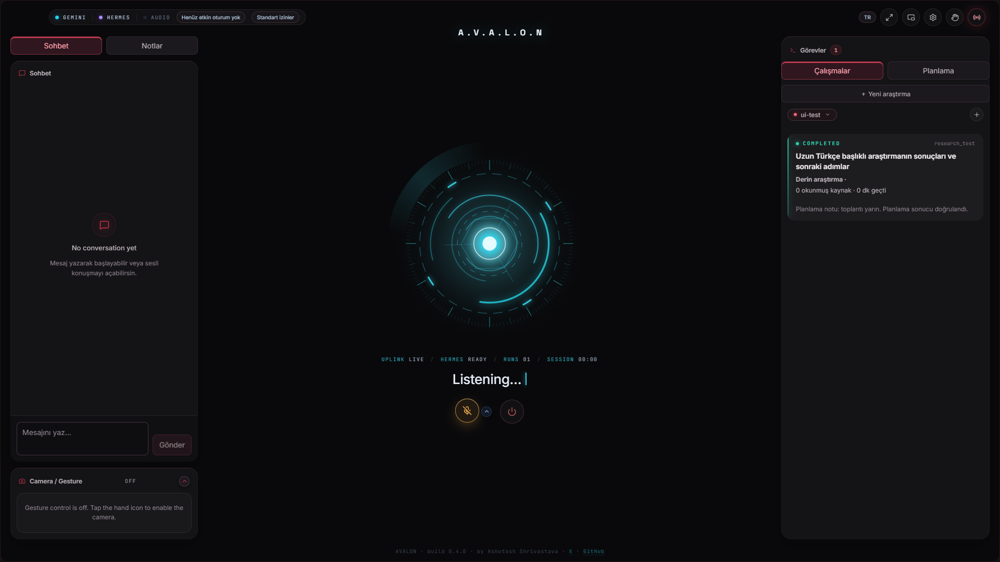
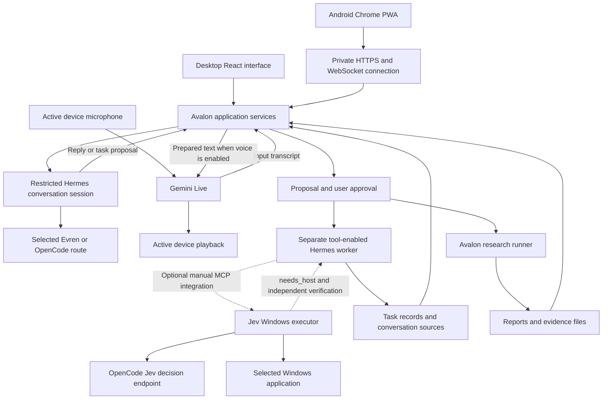
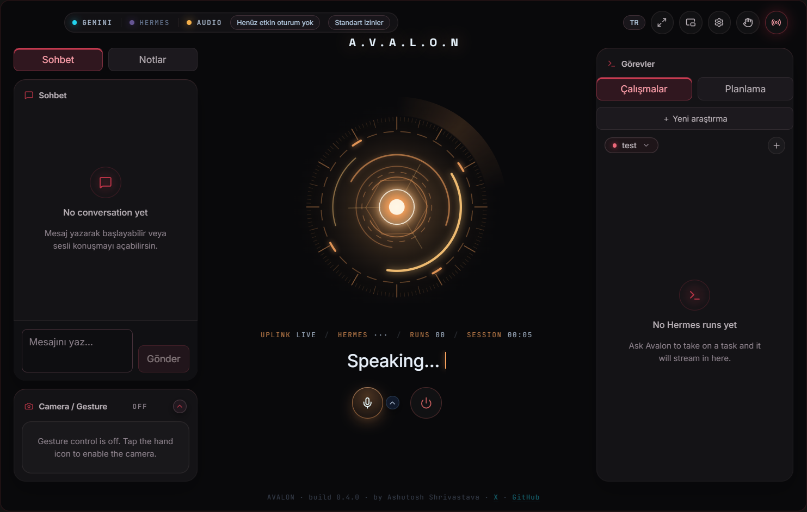
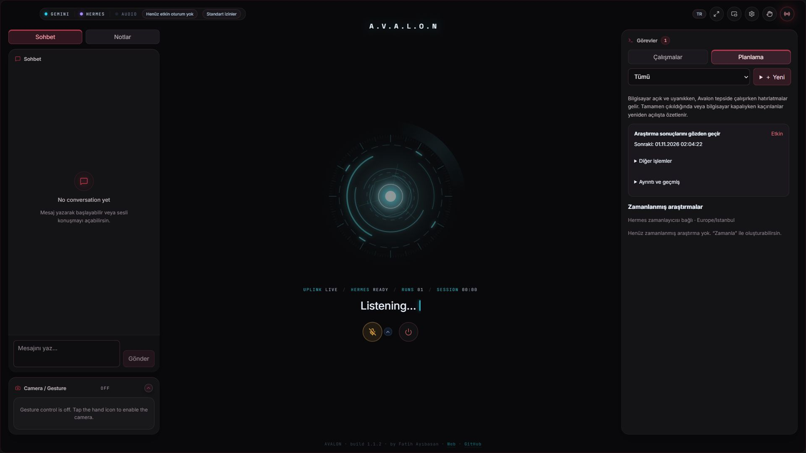
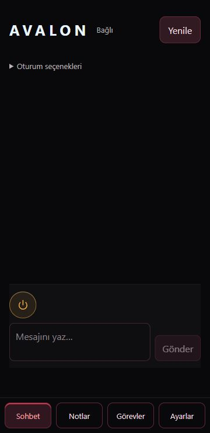
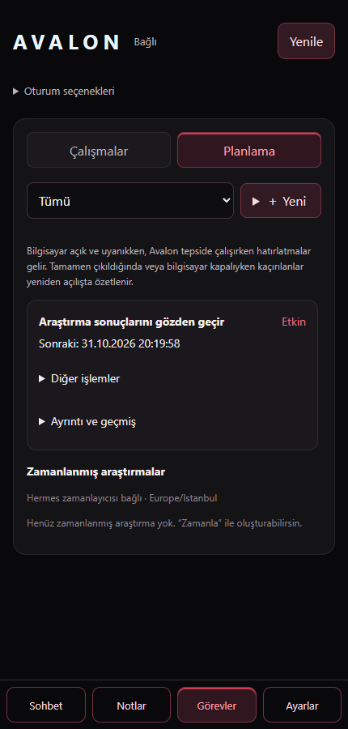
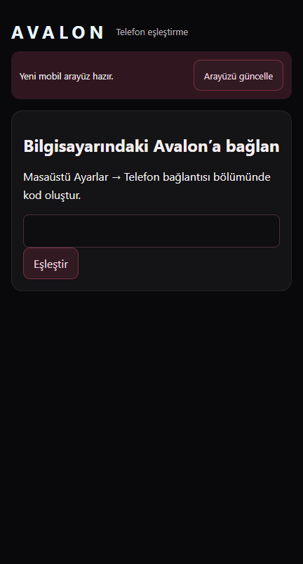

# Avalon

**A personal AI workspace for conversation, research, and computer tasks, available on the desktop and an Android phone.**

[Download Avalon 1.0.0 for Windows x64](https://github.com/fatihaybsn/Avalon/releases/tag/v1.0.0). First-time installations also require the runtime and account setup described under [Installation](#installation).

Avalon brings a conversational assistant, background workers, connected notes, research reports, reminders, and a planning workspace into one application. A request can begin as a typed message or a voice conversation, become a reviewed task, and continue in the background while the conversation remains available.

The application runs on a computer. Its Android interface connects to that same installation, so conversations, tasks, model choices, approvals, and results stay connected across devices. Model inference uses the configured external providers; running the interface locally does not make the language models offline.

**Hermes Agent provides the reasoning and execution environment. Gemini Live provides the implemented real-time voice connection. Evren and OpenCode are the configured brain-provider integrations.** Provider access and pricing are separate from the application itself.

<!-- SCREENSHOT SLOT: Desktop hero. Replace this file with a current capture of the final interface. -->


*Interface preview with example data. Screenshot files can be replaced without changing the documentation layout.*

[Capabilities](#capabilities) · [Accounts and costs](#accounts-and-costs) · [Installation](#installation) · [Jev computer use](#7-optional-jev-computer-use) · [Android setup](#android-setup) · [Technical reference](#technical-reference) · [Troubleshooting](#troubleshooting)

## Capabilities

### Conversation that can turn into work

Avalon supports typed messages and spoken conversation. A configured brain model prepares the answer; when voice is enabled, Gemini Live receives microphone audio and speaks the prepared response. Typed messages do not automatically open the microphone or start a voice session.

Ordinary discussion, current-information questions, and computer actions follow different paths. The conversation can search and read web sources. A request to create a file, operate an application, or perform another tool-enabled action becomes a task proposal. Execution begins after the proposal is approved. Progress, tool activity, questions, and results remain visible in task cards.

Typical requests include:

- Explain a technical subject, compare approaches, or discuss a project decision.
- Find current information and discuss the sources.
- Prepare a document or perform a local task through the available Hermes tools.
- Research a topic against a time limit and save a report with supporting evidence.
- Repeat an investigation on a daily or weekly schedule and report new or changed sources.
- Create a personal reminder and review its date and time before saving it.
- Search connected Markdown notes and previous task results in the current conversation.
- Continue a desktop conversation or review an approval from an Android phone.

Application control, browser work, messaging, and file operations depend on the tools enabled in Hermes and any required account sessions or permissions. Avalon does not include credentials for third-party accounts.

### Optional Jev desktop executor

An independent Windows pilot adds a second computer-use route: Hermes can delegate a bounded desktop task to **Jev**, which selects actions while Windows UI Automation and OCR identify the target controls. Hermes remains responsible for the user's instructions, requested text, visual help, and independent verification. OpenCode supplies Jev's fixed `jev-1.13-free` decision model.

A bounded Notepad pilot recorded a median save time of **11.2 seconds**, compared with an earlier **82.4-second** recording. The test setups differ; see [the results and their limits](#jev-windows-computer-use-speed-pilot).

This route is **optional and configured separately from the Hermes installer**. The live Avalon → Hermes → Jev → Gemini completion-audio path has now passed a real bounded Windows test; see [live integration verification](#live-avalon-integration-verification). It is not a replacement voice model or a normal brain-selector entry. The existing CUA route remains separate. Jev needs the complete customized source, its own isolated dependencies, an OpenCode credential, MCP registration, and a routing skill. See [the installation summary](#7-optional-jev-computer-use) and [the full Windows procedure](docs/JEV-WINDOWS.md).

### Research and planning

Research can be given a topic, purpose, preferred sources, output directory, model, reasoning setting, and maximum duration. The application separates planning, source collection, verification, and report writing. Results include a readable Markdown report and structured evidence files.

Research can run immediately or be scheduled once, daily, or weekly. The planning workspace shows upcoming runs, previous results, and controls for editing, pausing, resuming, removing, or running a schedule immediately. New and changed source counts help compare repeated investigations.

Personal reminders are managed separately. They do not run a language model every time they fire. A reminder can be completed, edited, paused, or postponed by 10, 30, or 60 minutes.

### Desktop and Android access

The desktop includes conversation and notes panels, a central voice interface, task cards, a planning workspace, and settings. Narrow windows switch to focused conversation, notes, and tasks views. A transparent Glass HUD can remain over other desktop applications, and optional on-device hand tracking provides gesture controls.

The Android interface is an installable Chrome web application. It supports typed and spoken conversation, task results, approvals, planning, notes, model selection, and settings. Notification registration allows task, input-request, research, and reminder notices to reach the phone. The computer remains the host for the application and its work.

### Language, voice, and model controls

A TR/EN preference controls new conversational replies and task instructions. English mode supplies an explicit English instruction; TR mode retains the existing language-following behavior. Some interface labels and fixed messages remain Turkish, so the application is not fully localized into two interface languages.

The brain provider, model, and supported reasoning setting can be changed from settings. A running task keeps its assigned route. Research forms also support a model and reasoning choice for that specific investigation.

Voice selection, microphone choice, startup sounds, and pitch-preserving playback speeds of 1.0×, 1.15×, 1.2×, and 1.3× are available. Conversation starts from the interface or keyboard shortcut; voice wake-word activation is disabled.

### Technologies in plain language

| Technology | Responsibility |
|---|---|
| Electron | Runs the desktop application and connects its interface to local services. |
| React and TypeScript | Build the desktop and mobile interfaces. |
| Hermes Agent | Maintains conversations, connects a brain model, and executes approved work with tools. |
| Jev Windows pilot, via MCP | Optionally executes bounded desktop tasks under a Hermes worker; installed separately. |
| Gemini Live | Receives speech and voices the prepared answers. |
| Evren and OpenCode | Provide the model endpoints configured in the brain selector, subject to provider access. |
| Tailscale Serve | Makes the computer's mobile interface available over a private HTTPS connection. |
| Browser push and a service worker | Register the phone for notifications and manage mobile interface updates. |
| Markdown and local storage | Keep connected notes, reports, task records, and planning data accessible. |

## Accounts and costs

**Avalon is free, open-source software under the [MIT license](LICENSE). It does not require an Avalon subscription. External model and tool services have their own eligibility, quotas, terms, and charges.**

A zero-cost setup is possible only when every selected service grants the required free access and usage remains within its limits. Unlimited free operation cannot be promised by this repository.

Provider information below was checked on **30 October 2026**:

| Service | Role | Account or key | Cost and availability |
|---|---|---|---|
| Evren | Default brain-provider integration | An Evren account and its own API key | Access, available credits, promotions, and quotas must be checked in the account. The repository does not establish permanent free entitlement. |
| OpenCode | Alternative brain-provider integration | An OpenCode Console API key | The source includes free-labelled model identifiers, but current official guidance restricts free-tier chat models to OpenCode and states that Hermes requests return HTTP 403. These entries must not be advertised as guaranteed working free models in Avalon. [Provider guidance](https://opencode.ai/v2/docs/console/harnesses/hermes). |
| OpenCode Jev pilot | Optional Windows action decisions through the TypeSafe SDK protocol | OpenCode key stored separately for Jev | The code fixes `jev-1.13-free`; account eligibility, quotas and billing must be checked. This is a different endpoint from the OpenCode brain/chat route above. |
| Gemini API | Real-time voice; optional semantic note indexing | A Google AI Studio API key | The documented Live models have a free tier, with provider limits; paid usage also exists. [Current pricing](https://ai.google.dev/gemini-api/docs/pricing). |
| Tailscale | Optional Android connectivity | A Tailscale account on the computer and phone | A free Personal plan is available for eligible personal use. [Plan terms](https://tailscale.com/pricing). |
| Web, browser, and other Hermes tools | Search, extraction, or additional task capabilities | Depends on the configured tool | Some tools need separate credentials or paid services. These are not included in the brain or voice keys. |

### How many API keys are needed

For the recommended **Evren brain plus Gemini voice** setup, without optional Jev:

1. **One Evren API key** for the brain model.
2. **One Gemini API key** for voice and, when enabled, semantic note embeddings.
3. **One locally generated Hermes API secret**, shared between the local Hermes API and Avalon. This is not a purchased provider key.

Enabling the optional Jev executor adds an **OpenCode credential stored for Jev**. With Evren and Gemini, this normally means three external provider credentials plus the generated local Hermes secret. If an eligible OpenCode credential already exists, it can be entered into Jev's separate store; Avalon brain settings do not transfer it automatically. See [Jev key storage](docs/JEV-WINDOWS.md#3-store-the-opencode-api-key).

An OpenCode Console key is optional and separate. A provider key from one platform must not be reused against another platform's endpoint. A direct OpenAI API key, Azure subscription, Firebase project, OpenCode CLI installation, or additional speech-to-text subscription is not required by the default setup.

The current brain selector supports the explicit Evren/OpenCode list documented below. OpenAI-compatible request formatting does not mean that every OpenAI, Azure, or Google model can be selected. There is no general-purpose OpenAI or Azure brain-provider selector in this release.

### Where credentials are obtained

- **Gemini:** [Google AI Studio API keys](https://aistudio.google.com/apikey). The account must have access to the selected Live model.
- **Evren:** [Evren platform](https://evren.ssyz.org.tr). The account holder must complete the platform's account, eligibility, key-generation, and any applicable terms steps. The API description is available at the [Evren OpenAPI endpoint](https://evren-llmapi.ssyz.org.tr/openapi.json).
- **OpenCode:** [OpenCode Console](https://opencode.ai). Current external-client access restrictions must be checked before this route is selected.
- **Hermes local API:** A strong random secret is generated locally during setup. It is not obtained from a model provider.
- **Phone push:** Avalon generates its own VAPID keys and registers the browser subscription. No separate Firebase API key is entered by the user.

Secrets belong in the local settings described below. They must not be committed to the repository or included in screenshots.

## Installation

### Supported installation target

The detailed setup below targets **native Windows 10/11 on a 64-bit PC and Android Chrome**. Windows does not require WSL or Docker for this setup. macOS/Linux packaging commands remain in the project, but the complete customized installation path documented here is Windows-first.

A concise agent-ready procedure is also available in [INSTALL-WINDOWS.md](INSTALL-WINDOWS.md). The required Hermes setup/verifier/start scripts, compatibility patch and manifest are included under `scripts` and `compat/hermes`. The complete optional Jev pilot is included under `integrations/jev`, with its source hashes in `compat/jev/source-manifest.json`. No separate desktop folder or unpublished local source archive is required. Check that these files are present in the checkout; do not substitute an arbitrary upstream runtime.

Required components:

- **Node.js 24 LTS and npm**, available from [Node.js](https://nodejs.org/en/download).
- **Git for Windows**, available from [Git](https://git-scm.com/download/win), including for a pinned Hermes source installation.
- **An Avalon-compatible Hermes source runtime**, described in the compatibility step below. Its installer provisions the managed Python environment.
- **A brain-provider key**; Evren is the default route in this source.
- **A Gemini API key and microphone access** for voice features.
- **Tailscale on the PC and Android phone**, plus Chrome on the phone, when mobile access is required.
- Internet connectivity for provider requests and initial dependency/model downloads.

An NVIDIA GPU, local model server, OpenCode CLI, and separate Hermes Desktop application are not prerequisites. Optional tools can introduce their own requirements.

PowerShell examples use `npm.cmd` to avoid the common `npm.ps1` execution-policy conflict. The clone example uses the GitHub owner **Avalon** and repository **avalon**.

### 1 Obtain and build Avalon

```powershell
git clone https://github.com/fatihaybsn/Avalon.git
Set-Location .\avalon
npm.cmd ci
npm.cmd run build
```

A downloaded source archive can also be extracted instead of cloning; the terminal should then be opened in the directory containing `package.json`.

`npm ci` installs the versions recorded in `package-lock.json`. The build command produces both `dist` and `dist-mobile`. A missing lockfile should be resolved from the intended release rather than silently deleting the file or upgrading dependencies.


### 2 Prepare the compatible Hermes runtime

**The supplied Windows compatibility installer must be used. Installing an arbitrary latest Hermes build is not sufficient.** The installer, patch, manifest, verifier, and guarded launcher are included in this release; no unpublished patch command is needed.

From the Avalon root, with this package's `scripts` and `compat` directories in place:

```powershell
powershell.exe -NoProfile -NonInteractive -ExecutionPolicy Bypass -File .\scripts\setup-hermes.ps1 -AvalonRoot .
```

The default dedicated home is `%LOCALAPPDATA%\Avalon\Hermes`, with its source checkout under `hermes-agent`. A different empty local directory can be selected with `-HermesHome "D:\Avalon Runtime\Hermes"`. A personal Hermes home must not be used as that destination.

The compatibility baseline is:

```text
Hermes base commit: bf0203a794a07aac3ff764972ab9087baa4e4f4e
Required conversation-contract versions: 1 and 2
Package: avalon-hermes-2026.10.30.1
Platform: native Windows x64
```

The installer fetches that exact commit, verifies the baseline, backs up the modified files, applies all 12 tracked-file changes and 8 added files, and checks the result. It then delegates dependency installation to the bundled, pinned upstream installer's PM stage. Its managed Python and supported tools are provisioned without a separate system-Python requirement. A missing Git can be bootstrapped privately from the upstream hash pin.

Native guarded launchers are created at `avalon-bin\avalon-hermes.exe` and `avalon-bin\hermes.exe`. They are deliberately separate from the ordinary `bin` directory that Hermes can maintain itself. The guard checks the source revision, patch/lock identity, selected runtime, compatibility imports, and update ownership before admitting a command. Deep verification also checks the 2,479-file production Python workspace inventory.

The setup command generates a local API secret, chooses a free loopback API port, and merges the matching connection fields into the specified Avalon checkout's `.env`. Existing provider keys and unrelated settings are preserved. Preexisting configuration/environment files that change are backed up under the dedicated Hermes home.

The default final checks start an authenticated WebSocket backend, verify its contract advertisement, and check the authenticated local HTTP API. They do not submit a model prompt. `READY` does not establish model-provider entitlement, speech quality, tool-account configuration, or physical Android notification delivery.

A download failure can be retried with the same command. An already correctly patched installation is verified rather than patched twice. An unowned destination, wrong revision, partial patch, unknown source changes, or incompatible package is preserved and rejected with an error. The installer does not reset an unknown dirty checkout.

#### Update policy

This dedicated source distribution records `updateMechanism: external` in its Hermes installation stamp, disables passive update checks, and rejects independent source/dependency updates through its guarded CLI. Its `config.yaml` includes:

```yaml
updates:
  check: false
  auto_switch_parked_branch: false
  pre_update_backup: quick
```

`updates.check: false` alone is not a version lock. The source/patch checks, external update ownership, native command guard, and guarded Avalon startup work together. Future Hermes upgrades require a new tested compatibility package. Manual administrator edits or an explicitly selected unrelated executable remain possible; the package does not claim an operating-system write lock.

The protected launch method in step 5 must be used so that both the explicit executable and fallback commands use the guarded runtime. The complete procedural reference is [INSTALL-WINDOWS.md](INSTALL-WINDOWS.md).


### 3 Configure Hermes credentials and the initial brain

The setup command creates these files under the selected dedicated home:

```text
%LOCALAPPDATA%\Avalon\Hermes\.env
%LOCALAPPDATA%\Avalon\Hermes\config.yaml
```

The Hermes `.env` already contains `API_SERVER_ENABLED=true`, `API_SERVER_HOST=127.0.0.1`, a selected `API_SERVER_PORT`, and a cryptographically generated `API_SERVER_KEY`. With `-AvalonRoot`, the matching value is stored in the repository `.env` as `API_SERVER_KEY`. The generated secret must not be replaced by an example placeholder or printed into an agent transcript.

The **Evren account key** is separate from that local secret. It can be entered in Avalon's Brain panel and saved with Apply. For an agent-assisted configuration, the following line can instead be merged into the dedicated Hermes `.env`, preserving the generated lines:

```dotenv
IRIS_EVREN_API_KEY=<EVREN_ACCOUNT_API_KEY>
```

The current implementation retains some `IRIS_*` configuration identifiers and the `.iris` settings directory. These are literal identifiers required by the running code; invented `AVALON_*` replacements will not work.

The installer prepares this initial provider configuration, preserving unrelated options on a retry:

```yaml
model:
  default: qwen3.8-flash-next
  provider: iris-evren
  base_url: https://evren-llmapi.ssyz.org.tr/v1

providers:
  iris-evren:
    name: Avalon Evren
    api: https://evren-llmapi.ssyz.org.tr/v1
    key_env: IRIS_EVREN_API_KEY
    api_mode: chat_completions

terminal:
  backend: local
```

The provider key belongs in `.env`, not directly in YAML. Avalon subsequently manages its own provider entries and model/reasoning aliases through the Brain panel. The helper does not provide an Evren, Gemini, or OpenCode account key.

Web-search/extraction and other tool credentials are configured separately through the pinned runtime's setup command when required:

```powershell
$avalonHermesHome = Join-Path $env:LOCALAPPDATA 'Avalon\Hermes'
$avalonHermesBin = Join-Path $avalonHermesHome 'avalon-bin\avalon-hermes.exe'
& $avalonHermesBin setup
```

Browser/computer-use capabilities depend on the supported Hermes tools, their downloads, enabled toolsets, and any required account permissions. Their credentials are not supplied by the brain/voice keys.


### 4 Verify the intended Hermes gateway

```powershell
powershell.exe -NoProfile -NonInteractive -ExecutionPolicy Bypass -File .\scripts\verify-hermes.ps1 -GatewayProbe
```

For a custom installation, the same `-HermesHome` path used during setup must be supplied. Without `-GatewayProbe`, the command performs the deep local identity/import check. With it, the authenticated WebSocket and local HTTP API checks are also run. Temporary probe processes are stopped; an already healthy authenticated API gateway is reused.

The normal app launch can autostart its configured gateway. If the gateway must remain available after Avalon fully exits, the exact pinned executable can be started separately:

```powershell
$avalonHermesHome = Join-Path $env:LOCALAPPDATA 'Avalon\Hermes'
$avalonHermesBin = Join-Path $avalonHermesHome 'avalon-bin\avalon-hermes.exe'
& $avalonHermesBin gateway run
```

That foreground terminal must remain open unless the same command is deliberately managed through Windows Task Scheduler or another owner-controlled startup mechanism. The installer does not silently add a Windows service or startup task. An existing gateway for the same home should be reused.

The API port is normally `8642` when available. If another process already uses it, setup selects a free port and writes the actual connection into Avalon. The setup must not stop an unrelated Hermes installation to acquire a port. Runtime version strings alone are weaker evidence than the verifier's source, workspace, and live contract checks.

### 5 Configure Avalon

From the Avalon project root, start the built application:

```powershell
powershell.exe -NoProfile -ExecutionPolicy Bypass -File .\scripts\start-avalon.ps1 -AvalonRoot .
```

For a custom runtime, the same `-HermesHome` value must be supplied. The startup terminal should remain open for this source-launch method. `-Build` can rebuild before launch; otherwise both existing builds are required. The helper checks compatibility, supplies the matching local API connection, and prepends the guarded alias to the application process's PATH. It does not change system/user PATH.

This helper launches the native Electron executable directly so a repository path containing spaces does not pass through the existing `.cmd` shell trampoline. This is the protected release entry point. Bare `npm start`, development commands, or directly opening a packaged executable bypass this outer preflight/PATH protection.

On first launch, the setup wizard collects the Gemini key, Hermes connection, display name, voice, and device permissions. The same settings remain accessible from the gear icon. Some controls currently display Turkish labels; the table includes their visible equivalents where relevant.

| Setting | Required value |
|---|---|
| Gemini API key | The Google AI Studio key. |
| Hermes API URL | `http://127.0.0.1:8642`, or the actual configured local port. |
| Hermes API key | The same local `API_SERVER_KEY` used in the Hermes `.env`. |
| Hermes home | The resolved absolute data-home path, for example `C:\Users\USERNAME\AppData\Local\Avalon\Hermes`. |
| Hermes executable | The absolute path to that installation's `avalon-bin\avalon-hermes.exe`. |
| Display name | The user's preferred name. |
| Voice | A supported Gemini voice, such as `Zephyr` or `Aoede`. |
| Voice model | The source default is `models/gemini-3.1-flash-live-preview`. This is a Live model, not a brain-model field. |
| Brain vault / note folder | An existing Markdown/Obsidian directory, if notes are required. |
| Automatic note indexing | Optional; disabled by default. Manual indexing can be used first. |

`Test Gemini` checks the entered provider credential. `Test Hermes` checks the local API connection. A successful credential check does not replace a real spoken-response or task test.

After saving, open **Settings → Beyin (Brain)**:

1. Select **Evren / Qwen 3.8 Flash Next** for the documented default setup.
2. Select a supported reasoning setting; `Default` is the initial conservative choice.
3. Run **Bağlantıyı dene (Test connection)**.
4. Inspect whether both model access and the tool/reply-format round trip were verified.
5. Choose **Uygula (Apply)** and confirm the effective route once any safe-transition wait has finished.

Selecting or testing a model does not apply it. A response without a verified tool round trip is weaker evidence than a complete tool-and-response test. Provider failures should remain visible; an agent should not silently substitute another provider or a paid route.

For an eligible OpenCode route, its Console key is entered in the same Brain panel and saved with Apply. The current provider restriction described under Accounts and costs must be resolved before this route is treated as usable.

#### Configuration files for agents and advanced setup

Avalon's settings are stored at:

```text
%USERPROFILE%\.iris\.env
```

The following template documents the relevant fields. Placeholder values must be replaced, and absolute paths must be resolved rather than leaving `%LOCALAPPDATA%` literally in the file:

```dotenv
GEMINI_API_KEY=<GOOGLE_AI_STUDIO_KEY>
GEMINI_LIVE_MODEL=models/gemini-3.1-flash-live-preview
GEMINI_LIVE_VOICE=Zephyr

HERMES_API_URL=http://127.0.0.1:<ACTUAL_LOCAL_API_PORT>
API_SERVER_KEY=<THE_SAME_LOCALLY_GENERATED_SECRET>
HERMES_HOME=C:/Users/USERNAME/AppData/Local/Avalon/Hermes
HERMES_BIN=C:/Users/USERNAME/AppData/Local/Avalon/Hermes/avalon-bin/avalon-hermes.exe

IRIS_USER_NAME="Preferred name"
IRIS_BRAIN_RELAY=true
IRIS_HERMES_TRANSPORT=interactive
IRIS_PERMISSION_MODE=standard
IRIS_CONVERSATION_LANGUAGE=en
IRIS_SPEECH_RATE=1
IRIS_LOAD_TEST_DATA=false
IRIS_BRAIN_AUTO_INDEX=false
```

The brain provider key remains in the Hermes `.env`; it should not be pasted into the Hermes API URL field. Brain model and reasoning preferences should be applied through the Brain panel so that selected and effective values remain consistent. Internal `APPLIED` state fields should not be manually forged.

`GEMINI_LIVE_MODEL` may retain another accessible, compatible Live model in an existing installation; this does not make arbitrary Gemini chat/TTS models compatible. Gemini Live is the only implemented voice backend in the current source. A separate voice-provider selector is not provided.

Normal UI setup does not require copying `.env.example`. The installer writes this checkout's Hermes connection into its repository-root `.env`. That file is loaded before the user settings and may override the same values. Voice keys and user preferences normally remain in the user configuration. Duplicate conflicting configuration should be avoided. Empty key inputs in settings preserve already saved credentials.

### 6 Validate desktop use before pairing a phone

The setup should be checked in this order:

1. Confirm an actual typed reply from the selected brain in a new conversation.
2. Start voice from the interface or `Alt+W`, grant microphone access, and confirm both transcription and an audible answer.
3. Request a small, reversible task in a dedicated test folder, review its proposal, and approve it.
4. Confirm real tool progress and the actual result in the task card.
5. Open the result and ask a follow-up about it.

Camera access is only needed for desktop gesture control. Typed work does not itself require microphone capture or Gemini audio generation; the default onboarding flow is nevertheless designed around the complete voice setup.

Only a configured, compatible desktop installation should be used as the basis for Android setup.

### 7 Optional Jev computer use

**This optional executor requires the separate setup below. The standard Hermes setup script does not install or enable it.** It is now connected and verified on the development Windows installation; a new installation must still complete its own credential/MCP/skill setup. Ordinary Avalon conversation, voice, research and mobile setup do not depend on Jev.

The full, ordered procedure is [Jev Windows setup](docs/JEV-WINDOWS.md). It covers source acquisition, isolated dependencies, OCR, credentials, exact Hermes MCP registration, the host skill, restart, cancellation and result verification. An installation agent must read that guide before configuring Jev.

| Item | Required value or destination |
|---|---|
| Reviewed source | Bundled at `integrations/jev`, including `mcp-runtime.mjs` and `typesafe_computer_use/opencode.py`; verified against `compat/jev/source-manifest.json`. Upstream base alone is insufficient. |
| Suggested Jev root | `%LOCALAPPDATA%\Avalon\Jev`, copied from the bundled source using the manifest-verified procedure in the guide. |
| Python dependencies | Separate `<JEV_ROOT>\.venv`; reviewed CPython 3.14.4, checked-in `uv.lock`, and `uv sync --locked`. Never install these packages into Hermes' environment. |
| Node dependencies | `npm.cmd ci` in the Jev root; Avalon's Node.js 24 also satisfies the pilot. |
| Jev decision model | Fixed `jev-1.13-free` through OpenCode's TypeSafe SDK endpoint. No automatic paid model/provider fallback. |
| OpenCode API key | Enter through `<JEV_ROOT>\scripts\Set-OpenCodeKey.ps1`; saved at `<JEV_ROOT>\config\opencode-key.dpapi` for the current Windows account. |
| Optional key alternative | `OPENCODE_API_KEY` in Jev's MCP process environment or its protected local `.env`; used when no saved DPAPI key exists. Never put a real key in Hermes YAML or a shared file. |
| Hermes registration | Merge `mcp_servers.jev_windows_pilot` into the selected `<HERMES_HOME>\config.yaml`, with real Node/source paths, `enabled: true`, `timeout: 200`, and `trust: untrusted`. |
| Host instructions | Copy [the proposed routing skill](docs/jev/windows-task-routing.md) to `<HERMES_HOME>\skills\productivity\windows-task-routing\SKILL.md`, preserving a backup. |

The bundled source is sufficient for the optional manual installation. If files are missing or do not match the Jev manifest, stop Jev-dependent steps and report the exact incomplete or altered file. Do not substitute the upstream base, distribute another account's DPAPI file, or copy an existing `.venv`.

The executor returns `needs_host` when it needs text, a URL, or image interpretation. The Hermes worker must answer with `typesafe_respond`, preserving `runId` and `requestId`; simply starting the MCP process is not a complete integration. A brain route unable to read the supplied image requires a supported vision tool or an explicit missing-capability result. The restricted conversation model must not gain desktop tools.

Jev uses a selected interactive Windows desktop and can change foreground focus. Only one Jev/CUA executor should act at a time. The real development-machine test verified the brain proposal, Jev host handoffs, exact saved text, matching Gemini completion speech and renderer playback acknowledgement. The result is scoped to that workflow; each new installation should run the opt-in live check. No Hermes core patch change is required by this MCP design; the existing source pin remains in force.

## Android setup

### 1 Prepare the private connection

Install [Tailscale](https://tailscale.com/download) on the PC and Android phone, then sign both devices into the same intended tailnet. Install or update Chrome on Android. Account authentication and permission prompts must be completed by the account holder.

From the Avalon project root:

```powershell
npm.cmd run setup:remote
```

The existing setup command discovers this PC's Tailscale DNS name, configures private Serve routing to the local mobile server, and saves the resulting HTTPS origin and port. If Tailscale asks for HTTPS/Serve consent, that step must be completed before retrying. The command checks for conflicting routing and does not enable public Funnel access. [Serve reference](https://tailscale.com/docs/features/tailscale-serve).

Avalon must then be fully restarted through the protected entry point so that the local mobile server opens with the saved settings:

```powershell
powershell.exe -NoProfile -ExecutionPolicy Bypass -File .\scripts\start-avalon.ps1 -AvalonRoot .
```

Add the same `-HermesHome` argument used during setup when a custom runtime directory was selected.

The generated `https://...ts.net` address belongs to this PC. Another user's address must not be copied from an example. The default mobile-server port is `8765`; the local Hermes API port is `8642`. These are different services.

In **Settings → Telefon bağlantısı (Phone connection)**, confirm the actual HTTPS address and a ready/running remote status. Routing changes should be made through the panel if a different port is required.

### 2 Pair the phone

1. On the desktop, open Phone connection and choose **Eşleştirme kodu oluştur (Create pairing code)**.
2. On Android, keep Tailscale connected and open the generated Avalon HTTPS address in Chrome.
3. Enter the six-digit code and choose **Eşleştir (Pair)**.
4. Confirm that the mobile workspace opens and the desktop reports the paired device.
5. Optionally choose **Install app / Add to Home screen** from Chrome.

The code is single-use, expires after five minutes, and has a limited number of attempts. The current server stores one paired-device record; pairing a replacement device replaces that record. No Android APK is required. Site-data deletion, cookie expiry, or desktop revocation can require pairing again.

### 3 Register and test notifications

Phone pairing, browser permission, push subscription, and notification preference are four separate states.

On the phone:

1. Open **Settings → Phone connection**.
2. Select **Bildirimleri etkinleştir (Enable notifications)**.
3. Grant the Chrome/Android notification permission when prompted.
4. Wait for confirmation that the notification registration is ready.
5. Enable **Telefona bildirim gönder (Send notifications to phone)**.
6. Select **Test bildirimi gönder (Send test notification)** and confirm delivery on the physical phone.

A disabled test button means the push registration has not been completed. A browser permission marked allowed is not sufficient by itself. Pairing should not be repeatedly reset to fix an unrelated notification-registration error.

The test action queues a notification; successful delivery must be checked separately. The test can be sent even when ordinary notifications are disabled. No Firebase project or manual VAPID configuration is required.

Tailscale must be connected to open Avalon, register the phone, send a command, or review a task. Once registered, a system push can be delivered over the phone's ordinary internet connection without the phone's Tailscale connection, provided the browser/OS allows it. To test that case, disconnect Tailscale on the phone and send the test from the desktop.

The PC must be awake, online, and running Avalon to send new phone notifications. A fully exited application does not continue hosting its mobile server or sending new pushes.

### 4 Validate phone conversation and tasks

A typed message should first be sent from the phone. Voice can then be started from the mobile conversation controls; microphone and speaker access should be confirmed through an actual short exchange. Finally, a small approved task should be checked from the phone through completion and result opening.

Only one device owns the active voice connection. Starting voice on the phone transfers ownership from the desktop. **Sesi bilgisayara al (Move voice to desktop)** restores desktop ownership. Leaving the page or putting it in the background can close phone voice; tasks continue on the computer.

## Agent-assisted installation

An installation agent should receive the following non-secret setup choices and obtain credentials through an appropriate private channel:

```text
Avalon repository URL or existing project directory:
Intended Windows account and dedicated Hermes data home:
Avalon compatibility release/manifest:
Preferred display name:
Brain provider and model:
Reasoning preference:
Voice required: yes/no
Connected Markdown folder, if any:
Android access required: yes/no
Phone notifications required: yes/no
Optional Jev executor required: yes/no
Bundled Jev source: integrations/jev; identity: compat/jev/source-manifest.json
Jev installation root and Windows account, if requested:
OpenCode credential available through a private setup channel: yes/no
```

The agent's procedure is:

1. Inspect installed software, the project root, existing processes, ports, and configuration locations without overwriting a working installation.
2. Verify that the required Hermes compatibility package is present. If it is absent, report that specific missing prerequisite and stop dependent steps; do not substitute an unmodified or arbitrary latest runtime.
3. Prepare the pinned source runtime, apply/verify the supplied compatibility package, and confirm the actual loaded source and advertised contract.
4. Install the locked Avalon dependencies and build desktop/mobile assets.
5. Generate or retain the matching local API secret; place provider keys only in their intended settings.
6. Configure the real absolute Hermes home/executable, user name, voice, and brain route. Apply the route through the model panel rather than marking it applied by hand.
7. If Jev is requested, follow [the complete Jev procedure](docs/JEV-WINDOWS.md): require the reviewed source, use its independent locked environment, store the OpenCode key privately, merge the MCP entry and routing skill, and verify worker discovery/cancellation and host handoffs. Keep this status separate from the already verified Hermes base.
8. Complete desktop reply, voice, proposal/approval, and result checks appropriate to the requested features.
9. If Android access is requested, configure the PC's private HTTPS route and obtain the account holder's authentication/permission steps on both devices.
10. Confirm pairing, push registration, notification preference, actual notification delivery, and phone interaction separately.
11. Deliver the actual launch command, data paths, private access address, selected/effective model, and any incomplete human step. Secrets should not appear in the handover.

Desktop success, phone pairing, and physical notification delivery must not be inferred from a successful build or a passing simulated test. The phone steps require access to the real phone or confirmation from its owner.

The compatibility package is included in this release. Keep the root `.gitattributes` file when publishing: it preserves the exact bytes of hash-verified Hermes and Jev assets on Windows checkouts. An agent should use the supplied setup/verifier/start scripts rather than inventing a patch or modifying Hermes source by hand. The actual keys, provider-account access, and physical phone permissions remain installation-specific inputs.

## Technical reference

### Architecture

Avalon separates conversation, execution, and audio delivery. The desktop Electron main process owns the services and the Gemini Live connection. React renders the interface and handles microphone capture and speaker playback. The mobile application calls the same application operations through an authenticated web adapter.



The conversation backend is pinned to `web_search`, `web_extract`, and `clarify`. Its actual tool inventory is checked before prompt submission. A broader tool inventory is rejected rather than silently granting computer access to the conversation session.

Computer work runs in hidden child worker sessions associated with the selected conversation and model route. An ordinary worker uses the active route captured at dispatch. A research form can specify a different route, which is saved with that investigation. Worker output is associated with the visible conversation and can be attached as a source for follow-up discussion.

Conversation output uses a validated envelope:

```json
{"reply":"The prepared conversational answer.","proposal":null}
```

A task proposal includes the goal, a short spoken readback, relevant context, constraints, acceptance criteria, and expected output. The application keeps the full execution brief while reading a concise confirmation once. A proposal ID, conversation identity, expiry, and the required confirmation state are checked before work is dispatched. Discussing a proposal is not execution approval.

Key implementation modules are `electron/main.mjs`, `voiceRelay.mjs`, `brainReply.mjs`, `hermesGate.mjs`, `hermesGatewayClient.mjs`, and `hermesInteractiveTransport.mjs`.

### Jev Windows computer-use speed pilot

An independent Windows pilot delegates desktop action decisions to **OpenCode `jev-1.13-free`**, using the existing Windows control infrastructure. The objective is to reduce the time spent waiting for the main model to reconsider each click, text entry, and save operation. A bounded task is delegated once and continues inside the same executor, requesting host help when needed.

#### What changed for the user

In the live Notepad test, the executor typed **“Hermes hız testi 01.”** and saved it to a new file. Success was verified by reading the file and comparing its exact UTF-8 contents.

| Measurement | Previous recording | Jev pilot |
|---|---|---|
| Correct text saved to a file | 82.4 seconds | **11.2 seconds** |
| Pilot execution finished | — | **12.5 seconds** |

The final three successful trials saved the file in **11.45, 11.20, and 11.04 seconds**. The table uses the median. Compared with the earlier recording, the observed save time was approximately **7.4 times shorter**, a reduction of about **86%**. These are measurements from different test setups, not a controlled estimate of the full application's speedup.

#### Implementation used in the test

- **Decision model:** OpenCode `jev-1.13-free`, called through the existing TypeSafe SDK.
- **Windows control:** the existing UI Automation, local OCR, and keyboard/mouse tools.
- **Task management:** one MCP executor retained task state and requested help from the host when needed.
- **Verification:** the saved file's actual content was checked independently of the screen and the model's completion decision.

During testing, OCR grouped adjacent menu headings into a single target. Text grouping was improved to keep those controls separate. A **Ctrl+S** save action guarded by target-window checks was also added. This reduced menu-opening and target-finding steps for this task.

#### How to interpret the result

**This result does not show that the whole system is 7.4 times faster for every task.** The previous recording starts at request dispatch; the new pilot starts with an already prepared empty Notepad window. A controlled test host supplied the text and output path. Qwen, Avalon orchestration, and spoken-response latency were not included in the new measurement. The previous Hermes test was not rerun.

The first two pilot attempts failed during menu interaction. After the fixes, all three subsequent trials produced the correct file. Jev stopped with low confidence after saving, so completion was established by the independent file-content check. “Pilot execution finished” includes that stop; it is not a claim that Jev returned a verified `DONE` decision.

**Demonstrated contribution:** this short type-and-save task produced a correct file in approximately 11 seconds using the Windows tools and Jev decision loop. Speed and reliability across broader tasks still need separate measurement. The work remained in the independent pilot; live Avalon/Hermes integration had not been applied at the time of these measurements on **31 October 2026**.

The aggregate [measurement data](docs/jev/speed-results.json) records the timings and comparison limits. No new live benchmark was run for this documentation update.

#### Live Avalon integration verification

After the independent speed pilot, the actual Avalon integration was connected and tested on **31 October 2026**. A real typed request passed through the selected Evren/Qwen brain, task proposal and one-time approval, a separate Hermes worker, Jev's Windows actions, real host text/image assistance, exact file verification, and Gemini completion speech. No model or host replies were simulated.

The new file contained exactly `Jev Avalon doğrulaması başarılı.` in UTF-8 with no final newline. The completion was `Jev doğrulaması tamamlandı.`; Gemini's transcription matched it, and the renderer acknowledged playback for that task. The complete check took **163.65 seconds**, including startup, brain turns, approvals and host assistance. This measures a different scope from the earlier 11.2-second deterministic-host save and is not an apples-to-apples speed comparison.

The successful workflow recorded **9 OpenCode Jev decision requests** and **15 other Qwen/model calls**: 11 worker turns, 2 conversation/context turns, 1 visual-analysis request and 1 automatic title request. This is **24 recorded text/vision model calls**, separate from the audio transport. Gemini used one Live connection with 7 speech-generation starts, including 2 interrupted attempts; these are streaming-session events, not 7 separate HTTP requests or 7 completed spoken replies. See [request-count evidence](validation/live-jev/model-request-counts.json).

The actual Python MCP worker also passed a separate observation-only cancellation check. The accompanying checks passed **272 Avalon tests, 208 Jev Python tests and 6 Jev MCP tests**. See [the live verification report](validation/live-jev/RESULTS.md) and [structured evidence](validation/live-jev/RESULTS.json).

This validates one bounded Windows workflow and completion-audio delivery. It does not certify every application, microphone speech recognition or physical Android operation. Fresh installations still need the documented keys, OCR, MCP registration and host routing skill.

### Configured brain models

The following is the **source allowlist**, not a live provider-availability or pricing guarantee. Refreshing a provider catalog updates visibility information for these entries; it does not automatically add every model offered by a provider.

| Provider | API model ID | Display name |
|---|---|---|
| Evren | `gemma-4-31b` | Gemma 4 31B |
| Evren | `qwen3.8-flash-next` | Qwen 3.8 Flash Next |
| Evren | `mimo-v2.6-pro` | MiMo V2.6 Pro |
| Evren | `deepseek-v4.1-flash` | DeepSeek V4.1 Flash |
| Evren | `glm-5.3` | GLM 5.3 |
| OpenCode | `beam-free` | Beam Free |
| OpenCode | `big-pickle` | Big Pickle |
| OpenCode | `deepseek-v4.1-flash-free` | DeepSeek V4.1 Flash Free |
| OpenCode | `flint-40b-free` | Flint 40B Free |
| OpenCode | `glm-5.3-flash-free` | GLM-5.3-Flash Free |
| OpenCode | `mimo-v2.6-flash-free` | MiMo-V2.6-Flash Free |
| OpenCode | `nemotron-3-ultra-free` | Nemotron 3 Ultra Free |
| OpenCode | `nemotron-3.5-lightning-free` | Nemotron 3.5 Lightning Free |
| OpenCode | `nemotron-3.5-super-vl-free` | Nemotron 3.5 Super VL Free |

All OpenCode rows above remain subject to the external-client restriction already described. A `free` suffix does not establish that a Hermes request is currently allowed. No client-identification workaround or silent switch to a paid model is part of the documented installation.

Provider endpoints are configured in `electron/brainModels.mjs` and `sidecar/brain_provider.py`:

| Provider | Inference base URL | Catalog URL |
|---|---|---|
| Evren | `https://evren-llmapi.ssyz.org.tr/v1` | `https://evren-llmapi.ssyz.org.tr/v1/models` |
| OpenCode | `https://opencode.ai/inference/openai/v1` | `https://opencode.ai/inference/v1/models` |

Normal conversation and task execution use Hermes sessions and Hermes' model transport. Catalog refresh is an HTTP request to the provider. The isolated model test uses the Hermes request builder/decoder with an OpenAI-compatible client and a harmless local addition tool; it is not a separate agent or an OpenCode CLI worker.

#### Reasoning and safe switching

Reasoning controls are declared per model in `electron/brainReasoning.mjs`. Evren routes support the configured on/off controls and selected model-specific effort values. Only some OpenCode entries have explicit effort controls. Unknown controls remain hidden; unsupported combinations are rejected.

The UI displays the effective wire setting. For example, the configured Evren Qwen `high` alias maps to `xhigh`; some DeepSeek/GLM aliases also map to provider-supported values. Reasoning-specific provider aliases keep previously started work attached to its original configuration.

Selected, applied, and observed effective routes are tracked separately. A safe transition waits for conversation, speech, proposal, and interaction boundaries. Expensive-model or native model-switch warnings are surfaced when Hermes requests them. Existing automatic model-fallback chains are rejected by the provider-preparation adapter rather than silently changing the requested route.

<!-- SCREENSHOT SLOT: Add a real Brain settings/model-selection capture here after the final interface is ready. Suggested file: docs/images/model-selection.png. -->

### Desktop workspace and controls

Wide desktop windows keep conversation/notes, the central voice area, and tasks visible together. Under 1100 pixels, focused workspace navigation takes priority. Window bounds and maximized state are retained, clamped to the available display area, and restored independently of HUD bounds.

<!-- SCREENSHOT SLOT: Desktop overview. Replace with the final wide-window capture. -->


| Control | Action |
|---|---|
| `Alt+W` | Start or wake desktop conversation. |
| `Alt+S` | Stop/sleep the desktop voice session. |
| `Alt+H` | Toggle Glass HUD; the configured HUD shortcut may differ. |
| Gear icon | Open setup and settings. |
| TR/EN control | Change the presentation-language preference for new turns. |
| Permission control | Choose standard permissions or full-access worker mode. |
| Notes search | Search connected memory/notes and the selected conversation's task results. |
| `Ctrl+F` in a supported reader | Focus the in-content search bar. |

Optional hand tracking is processed on the device with MediaPipe. Point-and-hold selects an interactive target, an open palm scrolls, two palms resize the reader, and a fist closes it. Required runtime assets may need an initial network download. Camera tracking frames are not sent to a model provider by the gesture module.

### Research execution

Research is implemented through `researchService.mjs`, `researchRunner.mjs`, `researchEngine.mjs`, `researchStore.mjs`, and `researchLeases.mjs`. The runner is a detached process separate from desktop audio. Shared SQLite leases limit active research turns to three slots across runners using the same research root.

The workflow is:

1. Validate the topic, output path, language, route, preferred sites, and upper time limit.
2. Create a plan for deep mode, with up to three independent questions.
3. Search and retrieve original source pages. Browser tools can assist when extraction is insufficient.
4. Seek corroboration, counter-evidence, and unresolved questions in additional deep-mode passes.
5. Match evidence quotations against retrieved source text.
6. Reserve the final 10% of the time budget for synthesis and save the report and evidence.

The UI offers 15/30/60/120-minute limits; the service validates 1–120 minutes. Thirty minutes is the default. The limit is a maximum, not a minimum running time. Deep completion requires sufficient source coverage, including at least three retrieved pages from two independent sites, along with the remaining completion checks.

Search snippets, login pages, access-denied responses, and a model's unsupported claim to have read a source do not count as successful retrieval. Exact quotation matching checks provenance within retrieved text; it does not independently establish semantic or real-world truth. Important inaccessible sources and unresolved questions remain visible in the result.

The runner exposes planning, collection, verification, and reporting phases. `completed`, `partial`, `failed`, `cancelled`, `interrupted`, and `needs_access` are distinct outcomes. Interrupted work preserves available output instead of being silently restarted or labelled complete.

Default research output is under the operating system's Desktop directory at `Avalon/Araştırmalar`, with a separate folder per run:

```text
plan.json       Questions and research criteria
findings.json   Worker findings and unresolved items
sources.json    Retrieved source records and text
evidence.json   Claims, quotations, URLs, and match status
report.md       Readable report with limitations and sources
summary.json    Run metadata and final state
```

Research workers use a checked tool inventory and instructions to stay within the assigned output directory. The directory instruction should not be mistaken for an operating-system container that prevents every possible out-of-directory access.

### Scheduled research and reminders

Research scheduling uses Hermes' native cron capability through `sidecar/research_scheduler.py`. Avalon saves its own run definition and installs an Avalon-owned launcher in the selected Hermes home's `scripts` directory. The native job starts that launcher without an extra model deciding how to dispatch it.

The scheduler verifies liveness, uses an occurrence identity and OS-owned lock to avoid duplicate/overlapping launches, and distinguishes successful dispatch from actual research completion. All research stages use the route saved in the schedule. Editing a schedule affects future runs; an active run keeps its existing specification.

Schedules and reminders use **Europe/Istanbul**. Recurring research verifies the scheduler's timezone or an equivalent system-clock configuration instead of silently changing global timezone settings.

Repeated research compares canonical URLs and hashes of retrieved text. Tracking fragments/parameters are normalized. Only a completed run advances the monitoring baseline. A successful repeat with no new/changed sources remains in history without producing the ordinary result notice. This is source-level change monitoring, not an exhaustive semantic listing database.

Personal reminders use `electron/reminders.mjs`, persisted occurrence IDs and revisions, and a local timer. No brain request is required to fire a saved reminder. A conversational reminder request opens a reviewable form; it is not automatically executed as a general worker job.

| Computer/application state | Personal reminders | Scheduled research | Phone hosting and new pushes |
|---|---|---|---|
| PC awake; Avalon and Hermes running | Timer and notices available. | Available when its dependencies are ready. | Available. |
| Avalon window closed; app still in tray | Available. | Available. | Available. |
| Avalon fully exited; Hermes scheduler running | Checked on next start. | Can run through the saved launcher. | Avalon server/push sender is stopped; records reconcile after reopening. |
| PC awake but offline | Local reminder timers can still fire while Avalon runs. | Network-dependent research cannot complete normally. | Remote access and new push delivery are unavailable. |
| PC asleep or off | Timely execution is unavailable. | Timely execution is unavailable. | Unavailable; an already queued external push may have its own delivery lifecycle. |

Missed reminder occurrences can be summarized after startup/resume. The application does not claim to wake a powered-off PC or provide an independent cloud scheduler.

<!-- SCREENSHOT SLOT: Planning, reminders, and scheduled research on desktop. -->


### Notes and the knowledge graph

A connected vault is a directory of Markdown files. The graph resolves wiki links and normal Markdown note links, including relative paths, encoded filenames, aliases, and headings. Ambiguous short names are not silently mapped to an unrelated note. Missing destinations are reported separately.

Lexical retrieval and optional Gemini embeddings are combined for note search. Index freshness uses content hashes, paths, and chunk identities, so deletion, renaming, and preserved timestamps are handled. Unchanged synchronization does not rewrite the committed index. Vault edits and index commits have separate watchers, preventing an index-write loop from causing another embedding pass or unnecessary map reconstruction.

The graph preserves existing node positions and pins when data is refreshed. Opening the graph is a read operation. The Notes panel and readers support result search, match counts, and previous/next matching text. This is not a general PDF/Word upload interface or a Markdown editor.

Automatic embedding is off by default. Enabling it or manually indexing sends relevant note text to the configured Gemini embedding service. Existing cached vectors and lexical search remain useful without automatic rebuilding; query embeddings can still use the API when semantic search is enabled.

### Voice delivery and interruption

Gemini Live receives 16 kHz PCM microphone input and returns 24 kHz PCM output. The renderer owns capture, echo-cancelled input, local speech activity detection, and queued playback. Gemini's conversation-role instructions are restricted to delivery and bounded interface coordination; Hermes prepares the normal conversational content.

`VoiceRelay` tracks authorized utterances, queues, active playback, tool state, and conversation generations. A result is not marked heard merely because the provider finished generating bytes. The renderer acknowledges the actual final playback boundary. Stale or duplicate acknowledgements cannot complete a new proposal readback.

User speech interrupts the active readout. An interrupted result is not automatically resumed after answering the new question; its text remains accessible for an explicit request. Connection recovery is separate from that user-interruption behavior. An ordinary reply that produces no audio for the configured recovery interval can receive one bounded connection retry; repeated failure produces an error instead of an unlimited reconnect loop.

An explicit no-speech status in place of a task result is not treated as delivery of that result. Minor transcription/pronunciation differences remain diagnostic rather than automatically withholding all audio. Gemini remains generative, so perfect transcription and verbatim speech cannot be guaranteed.

Pitch-preserving tempo uses `@soundtouchjs/core`. Each utterance keeps its chosen rate, carries processing state across chunks, flushes its final buffer, and clears processing/playback on interruption. This shortens playback duration; it does not accelerate the model's reasoning or network response.

### Native interactions and permissions

The gateway client advertises support for Hermes server-to-client requests, then maps approval, clarification, sudo, and secret requests into the existing interaction cards. Replies use the original request ID; cancellation, reconnect restoration, duplicate requests, and multiple clarification questions are handled. Legacy interaction events remain supported.

Standard mode retains ordinary native approval requests. Full-access mode applies Hermes' session-scoped `yolo` setting to workers, verifies the receipt, and attempts to restore previous settings if application fails. It does not broaden the restricted conversation toolset or remove the initial task-proposal gate. Passwords and missing-information questions remain interactive.

Sensitive input stays in the secure interface; it is not spoken through Gemini. Permission cards retain their details on screen while the voice reads a short permission notice. Resolving a request removes that request's pending readout rather than allowing an obsolete warning to play later.

### Mobile transport and updates

`electron/remoteServer.mjs` exposes a loopback HTTP server and separate event/audio WebSockets. Tailscale terminates the private HTTPS connection. Host/origin checks, authenticated cookies, explicit method allowlists, request-size limits, and bounded socket buffers protect the application adapter. The phone does not connect directly to the Hermes model gateway.

Pairing stores a hash of the device token. Mutation receipts bind a request ID to the operation/content so that a retry does not silently dispatch the same action again. Desktop/mobile voice ownership carries a generation number; audio and playback acknowledgements from an old owner cannot authorize a new session.

Push registration uses browser-generated subscription keys and application-generated VAPID credentials. The outbound subscription endpoint is restricted to the allowed browser push services. Notices carry short generic text and record IDs rather than full results or secrets. The queue removes expired, viewed, or no-longer-current notices and uses bounded delivery attempts. Push failure does not stop the underlying task.

The mobile build is a separate Vite entry under `src/mobile`. It includes a PWA manifest, service worker, and a `version.json` build stamp. A build in the source directory does not replace the assets already bundled in an older executable; the running Avalon instance determines which mobile files are served.

<!-- SCREENSHOT SLOT: Mobile conversation. Replace with a populated conversation using non-sensitive example content. -->


<!-- SCREENSHOT SLOT: Mobile planning, scheduled research, and reminders. -->


The mobile Refresh action checks both application state and the available UI build. A new build produces an explicit update notice. Voice, an active operation, an unsent message, or an open form blocks update application until it can be done safely. A service-worker activation does not forcibly reload a conversation.

If a previously installed worker keeps serving an obsolete homepage, opening the same private origin once with `?_avalon_build=refresh` can bypass that legacy navigation cache. The update button then activates the available worker. Pairing and notification data do not need to be erased as the default repair.

<!-- SCREENSHOT SLOT: Safe mobile update notice. -->


iOS, phone/WhatsApp calls, mobile desktop gestures, and continuous lock-screen voice are outside the documented mobile scope.

### Configuration and local data

| Location | Purpose |
|---|---|
| `%USERPROFILE%\.iris\.env` | Avalon keys, connection settings, and preferences. |
| `%USERPROFILE%\.iris\remote-state.json` | Managed pairing, push credentials, notification preference, and receipts. |
| `%USERPROFILE%\.iris\message-receipts.json` | Typed-message deduplication records. |
| `%USERPROFILE%\.iris\run-registry.json` | Local task metadata and delivery state. |
| `%USERPROFILE%\.iris\reminders.json` | Reminder definitions, occurrences, revisions, and history. |
| `%USERPROFILE%\.iris\research\` | Research/schedule records and worker coordination. |
| `%USERPROFILE%\.iris\brain-index\` | Cached note index, separated from the vault. |
| `%USERPROFILE%\.iris\window-layout.json` | Normal desktop bounds and maximized state. |
| Selected `HERMES_HOME` | Hermes configuration, sessions, memory, cron records, and tool state. |
| Selected research output directory | User-facing reports and structured evidence files. |
| Selected Markdown vault | User-owned notes; graph/read operations do not edit these files. |

Missing data files can simply mean that the corresponding feature has not yet been used. The existing key names are an implementation compatibility requirement, not a second product name.

Common preferences include:

| Setting | Default or meaning |
|---|---|
| `IRIS_BRAIN_RELAY` | `true`; Hermes-owned conversation and Gemini voice relay. |
| `IRIS_HERMES_TRANSPORT` | `interactive`; native Hermes gateway protocol. |
| `IRIS_CONVERSATION_LANGUAGE` | `tr` unless `en` is explicitly selected. |
| `IRIS_PERMISSION_MODE` | `standard`; `full` applies native worker-session auto-approval. |
| `IRIS_SPEECH_RATE` | `1`; supported rates are 1, 1.15, 1.2, and 1.3. |
| `IRIS_BRAIN_PATH` | Absolute path to the optional Markdown vault. |
| `IRIS_BRAIN_SEMANTIC` | `true`; enables available semantic retrieval. |
| `IRIS_BRAIN_AUTO_INDEX` | `false`; automatic embedding maintenance is opt-in. |
| `IRIS_AUTO_SLEEP_SECONDS` | `30`; idle voice standby, with speech/activity protections. |
| `IRIS_AUTO_WAKE_ON_HERMES` | `true`; subject to explicit voice intent and lifecycle checks. |
| `IRIS_SOUNDS` | `true`; interface sounds. |
| `IRIS_STARTUP_SOUNDS` | `true`; startup synthesis also follows the master sound preference. |
| `IRIS_STARTUP_SOUND_VOLUME` | `55`; startup effects only, on a 0–100 scale. |
| `IRIS_REMOTE_ENABLED` | `false`; enabled by remote setup or the phone connection panel. |
| `IRIS_REMOTE_ORIGIN` | This PC's private HTTPS origin. |
| `IRIS_REMOTE_PORT` | `8765`. |
| `IRIS_HERMES_CWD` | Optional worker workspace override. |
| `IRIS_HERMES_PROTECTED_PATHS` | Optional protected-path policy override. |

The usual setup uses the interface instead of editing these values. Brain selection, saved per-model reasoning preferences, and applied-state fields are managed by the Brain panel. The dormant legacy conversation path and archived wake-word assets should not be treated as alternative supported setup methods.

Conversation, task prompts, attached note text, and voice can reach the configured model providers. Camera gesture processing stays local. Optional embeddings send note/query content to the embedding provider. A private Tailscale connection controls remote access to the application; it does not make provider inference local. Browser push uses the browser vendor's delivery service.


### Optional history maintenance

Installation instructions are maintained in this README and its linked Windows/Jev guides. For optional conversation deletion and a recoverable reset of local task-card history, see [session and task-history maintenance](docs/MAINTENANCE.md). These are not installation prerequisites and must not be run as automatic setup cleanup. `Kurulum.md` is retained only as a short redirect to the current documentation.

## Hermes compatibility package design

The Windows package is implemented and distributed with the application source. Its layout is:

```text
compat/hermes/
  compatibility.json       Base revision, post-patch identities, assets and locks
  avalon-hermes.patch      Complete changes, including newly added files
  upstream-install.ps1    Exact baseline's upstream Windows bootstrap
  LICENSE.hermes          Hermes license/notice

scripts/
  setup-hermes.ps1         Dedicated source, patch, PM and connection setup
  verify-hermes.ps1        Deep identity check and optional startup probes
  start-avalon.ps1         Verified desktop entry point and guarded PATH
  Avalon.Hermes.Common.psm1
  hermes-runtime.py        Runtime preparation, native guard and local probes

tests/
  test-windows-package.py  Disposable Windows installation/failure-path tests
  test-gateway-client.mjs  Actual Avalon gateway client and process cleanup
  test-http-client.mjs     Saved API settings and actual HTTP client
  test-brain-adapter.mjs   Managed Python/provider adapter discovery
  test-hermes-regressions.ps1
```

### Source and dependency identity

The patch includes 12 changed tracked files and 8 additions, including four regression files. An ordinary tracked-only diff would omit required production helpers and tests. The base commit, patch/bootstrap/support-file digests, pre/post source identities, dependency lock identities, required protocol versions, and 2,479-file runtime Python inventory are recorded in the manifest.

Text-file fingerprints normalize CRLF to LF so a line-ending difference is not mistaken for different logic. Patch/package bytes have exact SHA-256 digests. User keys, settings, memories, device tokens, databases and machine-specific installation paths are excluded from the public manifest.

Hermes PM installs dependencies from the pinned source/locks. A separate `pip install` or a guessed system interpreter is not part of installation. Verification checks the selected PM generation and customized files in its editable workspace as well as the modules the running interpreter resolves.

### Guarded launch and updates

The installed native `avalon-bin\avalon-hermes.exe` works with Electron's direct Windows process spawning. It binds the intended home, checks its guard/manifest/receipt before loading the guard, and validates the runtime before handing over to Hermes. The separate guarded `hermes.exe` alias is placed first on the protected application's PATH; Hermes' normal launcher repair is free to maintain its own ordinary `bin` directory.

Startup checks cover the source revision and expected patch/lock state, unexpected tracked/untracked changes, compatibility imports/workspace files, Python identity, and external update ownership. `verify-hermes.ps1` performs the deeper workspace inventory check. Independent update/dependency-mutation commands through the guarded CLI are refused. Passive checks are disabled, and the distribution stamp declares external update ownership.

This protects the documented launch path against accidental incompatible updates. It does not prevent an administrator from changing files or deliberately running another executable. Bare development/packaged launches do not obtain the PowerShell entry point's outer preflight and fallback PATH protection.

### Installation and recovery behavior

Setup serializes concurrent installs to one home, refuses an unowned destination, checks the unmodified base before patching, and checks the complete result afterward. A matching patched tree is accepted without applying the patch again. Unknown revisions, dirty/partial patches, changed support files and incompatible installed manifests are preserved and rejected. No automatic hard reset, source upgrade, user-data downgrade or blind migration is performed.

Existing provider credentials and unrelated environment options survive connection setup. Backups remain under the dedicated home rather than being added to the repository. A local API secret is generated once and reused. A busy default API port leads to a different local port, without terminating the previous listener.

Relative paths are resolved against PowerShell's active location, including after `Set-Location`. Child-process PowerShell module paths are normalized so a PowerShell 7 parent does not hide Windows PowerShell 5.1 built-ins. These changes affect the installation/application processes, not the machine's module settings.

The installed Hermes home contains path-bound environments and launchers and should not be moved. A different runtime path requires a fresh installation at that path. The downloaded compatibility package itself can be moved; the installed guard is self-contained.

The installer never substitutes a successful source check for live WebSocket/API readiness, provider access, real speech, or physical mobile notification confirmation. See [the runbook](INSTALL-WINDOWS.md) and [actual validation results](validation/RESULTS.md).

### Custom behavior that must be preserved

The custom Hermes `iris_contract` is applied to the admitted conversation turn as a temporary system-prompt extension, with the previous extension restored even after failure. It is restricted to the intended voice surface and read-only conversation tools. Source context remains bounded and is not treated as execution permission. Busy-queue envelopes preserve their own contract rather than merging unrelated instructions.

Contract v2 can request one bounded final-reply recovery for the specifically verified Evren/Qwen route. A completed plain-text response may be converted to the expected JSON envelope before its first durable assistant-message write. The extra request is limited, tool-free, cancellable, and does not count as user approval. Valid responses, malformed structured data, other routes, hidden source turns, and worker tasks are not general retry targets.

The recovery schema contains ordinary task-proposal fields; special research/reminder form recovery is not established. It is not a universal protocol-repair layer. The four custom regression files exercise these constraints through Hermes' canonical test runner in a separate PM-built test environment.

## Development and packaging

### Source layout

```text
electron/          Desktop services, Gemini relay, Hermes clients, model routes,
                   research, reminders, mobile server, notes, window management
src/components/    Shared desktop/mobile interface components
src/hooks/         Audio, gestures, and interface lifecycle hooks
src/mobile/        Android PWA entry, transport, push, updates, service worker
src/styles/        Desktop, HUD, graph, and workspace styling
sidecar/           Python bridges to Hermes providers and native cron
mobile/            Mobile HTML entry
public/            Runtime audio/VAD/wake-word assets
scripts/           Development, setup, packaging, and validation commands
integrations/jev/  Bundled customized Jev Windows source; independent dependencies
compat/jev/        Jev source identity and file hashes
test/              Node tests and Python scheduler-adapter tests
build/             Desktop/tray/mobile icon assets
```

### Available commands

For the protected Windows release, installation and launch use:

```powershell
powershell.exe -NoProfile -ExecutionPolicy Bypass -File .\scripts\setup-hermes.ps1 -AvalonRoot .
powershell.exe -NoProfile -ExecutionPolicy Bypass -File .\scripts\verify-hermes.ps1 -GatewayProbe
powershell.exe -NoProfile -ExecutionPolicy Bypass -File .\scripts\start-avalon.ps1 -AvalonRoot .
```

The npm commands below remain available for development/building. Raw Electron/npm launch commands bypass the protected wrapper's outer preflight and PATH setup.

| Command | Purpose |
|---|---|
| `npm.cmd ci` | Install the locked dependency graph. |
| `npm.cmd run dev` | Start the Vite/Electron development workflow. |
| `npm.cmd run build` | Type-check and build desktop plus mobile assets. |
| `npm.cmd run build:mobile` | Type-check and build the mobile assets. |
| `npm.cmd run start:prod` | Open the existing production build. |
| `npm.cmd start` | Build and launch the production application. |
| `npm.cmd run setup:remote` | Configure the private Tailscale Serve route. |
| `npm.cmd test` | Run the Node test suite. |
| `npm.cmd run verify` | Run tests, Electron syntax checks, both builds, and Python syntax checks. |
| `npm.cmd run test:workspace-ui` | Build and check simulated desktop/mobile interactions and layouts. |
| `npm.cmd run test:mobile-update-ui` | Build and reproduce/check the PWA cache-upgrade flow. |
| `npm.cmd run test:research-ui` | Build and check the research/planning interface. |
| `npm.cmd run test:window-layout` | Build and check window/HUD restoration. |
| `npm.cmd run test:startup-ui` | Build and check startup presentation/audio readiness. |
| `npm.cmd run package:win` | Build a Windows directory package. |
| `npm.cmd run dist:win` | Run the configured Windows distribution target. |

The configured Windows target is a directory package; an MSI/NSIS installer should not be assumed. Hermes remains an external compatible runtime. Native Python bridges are unpacked from ASAR so the external interpreter can open them.

`npm run verify` expects an accessible `python` or `py` command for its compile check. Running Avalon itself uses the Hermes managed interpreter candidates for its adapters. A system Python should not be used to install arbitrary dependencies into Hermes' managed environment.

Real-service commands include `test:brain`, `test:brain-models`, `test:relay`, `test:research`, `test:research-schedule`, and `test:live-search`. They can use credentials, model quota, live network services, and temporary test sessions/files. They should be invoked deliberately, not bundled silently into a basic install. The older live sleep/speech checks exercise the legacy architecture and do not establish current relay readiness.

The prior isolated validation for this source passed 272 Node tests, both builds and syntax checks, plus six scheduler-adapter tests. Simulated interface and PWA-upgrade checks also passed. These results are not evidence of current provider access, physical microphone quality, or Android notification delivery on a new PC.

### Screenshot locations

The current captures use example data. Final captures can replace these files:

| File | Intended image |
|---|---|
| `docs/images/desktop-voice.png` | Desktop hero with voice controls. |
| `docs/images/desktop-overview.png` | Wide conversation, notes, and tasks layout. |
| `docs/images/planning-desktop.png` | Reminders and scheduled research. |
| `docs/images/mobile-chat.png` | Android conversation and bottom navigation. |
| `docs/images/mobile-planning.png` | Android planning and reminder controls. |
| `docs/images/mobile-update.png` | Controlled PWA update notice. |

An additional model-selection slot is marked by an HTML comment in the technical section. No broken image link is inserted for that future capture. Screenshots should use non-sensitive example content and avoid keys, pairing codes, private hostnames, or personal notes.

## Troubleshooting

| Symptom | Checks and corrective direction |
|---|---|
| Conversation-contract error | Confirm the exact Hermes base, complete patch, actual imported source, and ready advertisement. Do not install latest Hermes as an automatic fix. |
| Hermes API unreachable | Check gateway ownership, loopback port, actual home/executable, and matching local secret. An HTTP health check alone does not prove the custom conversation contract. |
| Jev tools missing | Confirm the complete customized source, MCP registration in the actual Hermes home, matching server name, worker toolset, and a restarted worker. The generic MCP JSON is not Hermes YAML. |
| Jev key cannot decrypt | Run under the Windows account that saved it, or re-enter it through `Set-OpenCodeKey.ps1`; do not log `Read-Key.ps1` output. |
| Jev pauses at `needs_host` | The worker must inspect the request/image and answer with `typesafe_respond` using the exact IDs/schema. Check host vision support and the overall deadline. |
| Jev OCR unavailable | Install an available Windows OCR language, then repeat the local OCR readiness check. |
| No provider key | Place the key in the intended provider location. The local Hermes secret is not a model key. |
| OpenCode HTTP 403 | Check the current external-client/free-model restriction. Repeated pairing, a new Gemini key, or relabelling a request does not resolve provider eligibility. |
| Evren access or terms error | Complete the account's legitimate access/terms flow, inspect quotas and model availability, and test the selected route. |
| Model responds but tools are unverified | Complete the model/tool round-trip check before relying on tool execution. Do not report full compatibility from text generation alone. |
| A selected model is still pending | Complete the current conversation, readout, proposal, or interaction and inspect effective status. Do not manually forge applied-state fields. |
| No voice or unsupported model | Check microphone/output permissions, the Gemini key, Live-model access, and the active voice owner. A standard chat/TTS model name is not a Live-session substitute. |
| Phone cannot open Avalon | Check that Avalon is running, both devices are in the intended tailnet, HTTPS/Serve is ready, and the URL belongs to this PC. |
| Notification permission allowed, test disabled | Finish push registration from the phone; permission alone is not a saved subscription. |
| Test queued but no phone notice | Check Chrome/Android notification settings, internet, subscription status, and the running desktop push sender. Confirm actual delivery. |
| Mobile interface remains old | Confirm which desktop instance serves `dist-mobile`, then use the safe UI update flow; the one-time build query can migrate a legacy navigation cache. |
| Scheduled research did not start | Check PC availability, actual Hermes scheduler liveness, Istanbul timezone compatibility, saved launcher/runtime paths, and last dispatch/run errors. |
| Notes look stale | Check the vault path and index status; use manual sync or the intentional automatic-index setting. Lexical and semantic indexes have different maintenance needs. |
| Verification cannot find Python | Provide the supported `python`/`py` command for compile checks without modifying Hermes' managed packages. |

## License

Avalon is distributed under the [MIT license](LICENSE). The repository and any distributed dependencies must retain their applicable license and copyright notices.
